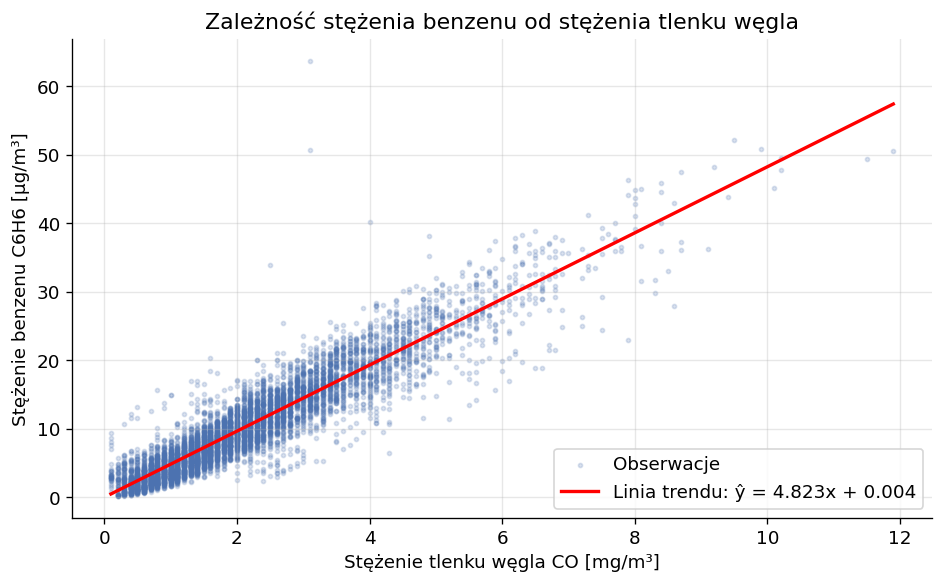
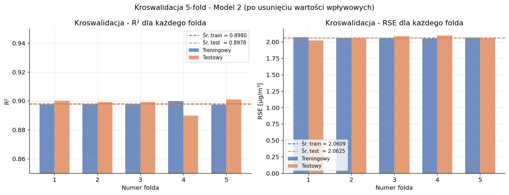
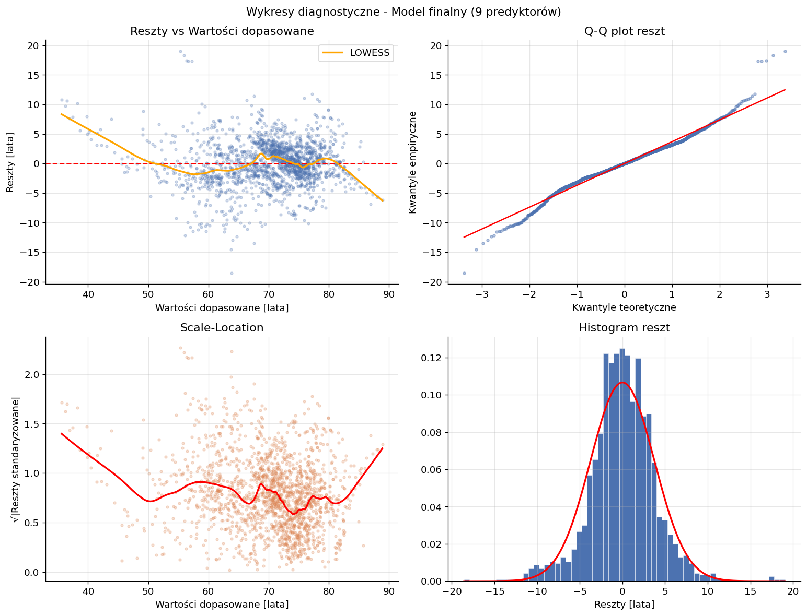
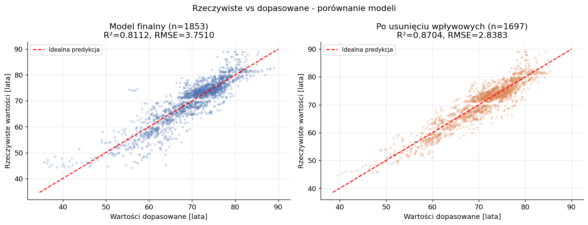

# Linear Regression Analysis: Air Quality & Life Expectancy

Two complete regression studies covering the full workflow: data cleaning, model building, assumption diagnostics, handling influential observations and validation.

 

> Full analysis: [`regression_analysis.ipynb`](regression_analysis.ipynb). Notebook text and chart labels are in Polish.

## Part I: Simple linear regression (air quality)

**Question:** How well does carbon monoxide (CO) concentration predict benzene (C₆H₆) levels in urban air?

- **Data:** [UCI Air Quality](https://www.kaggle.com/datasets/fedesoriano/air-quality-data-set). Hourly readings from a multi-sensor device at street level in an Italian city, March 2004 – February 2005 (9,357 observations).
- **Cleaning:** sensor error codes (`-200`) were converted to NaN. A column with 90% missing values was dropped, and rows missing the dependent or predictor variable were deleted (listwise deletion).
- **Diagnostics:** Shapiro-Wilk and Jarque-Bera (normality), Breusch-Pagan and White (heteroscedasticity), Durbin-Watson (autocorrelation), influential observations.

| Model | R² | RSE [µg/m³] | n |
|---|---|---|---|
| Full data | 0.867 | 2.715 | 7,344 |
| Influential points removed | **0.898** | 2.061 | 6,930 |
| 5-fold cross-validation (test mean) | 0.898 | 2.063 | – |

**Interpretation:** each +1 mg/m³ of CO is associated with about **+4.9 µg/m³ of benzene**. This makes physical sense because both come from vehicle exhaust. Cross-validation shows almost no overfitting (|ΔR²| = 0.0002).
**Limitations:** hourly data are autocorrelated (DW = 0.41), and residual variance grows at high concentrations.

## Part II: Multiple linear regression (life expectancy)

**Question:** Which health, economic and social factors explain life expectancy across countries?

- **Data:** [WHO Life Expectancy](https://www.kaggle.com/datasets/kumarajarshi/life-expectancy-who). 193 countries, 2000–2015, 22 variables.
- **Workflow:** full model with 14 predictors → multicollinearity reduction (VIF > 5 removed) → forward and backward stepwise selection (both gave the same 9 predictors) → influential observations removed.

| Stage | Result |
|---|---|
| Full model (14 predictors) | R² = 0.812, RMSE = 3.75 |
| Final model (9 predictors) | R² = 0.811, all predictors significant, VIF < 5 |
| Influential points removed | **R² = 0.870, RMSE = 2.84 years** |

**Key determinants:** the Human Development Index and years of schooling have a positive effect. Adult mortality and HIV/AIDS have a negative effect. This agrees with the public health literature.
**Limitations:** panel data (country × year) cause autocorrelation, so fixed- or random-effects panel models would be a natural next step.

## Tech stack

Python · pandas · NumPy · statsmodels · SciPy · scikit-learn · Matplotlib · Seaborn · Jupyter

## How to run

Download the datasets from the links above (`AirQuality.csv`, `Life Expectancy Data.csv`), place them next to the notebook and run it.
